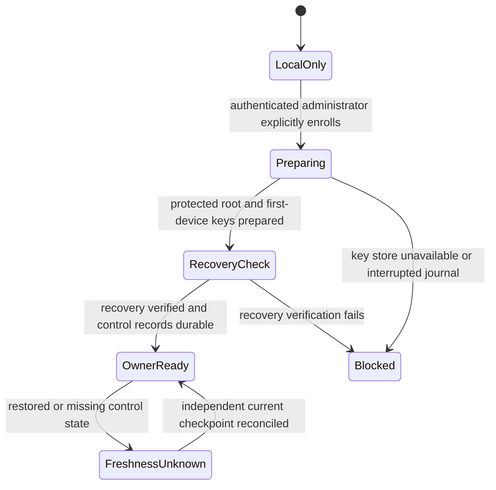

# Owner trust bootstrap and compatibility contract

Status: normative contract for the experimental S2–S7 implementation. This supplements
[the architecture](stage-four-sync.md). “MUST” identifies a release requirement;
platform evidence and remaining production gates are recorded separately.

## Initial owner bootstrap

1. The initiating session MUST be an authenticated local administrator. Anonymous
   loopback access, the legacy administrator API key and profile export grants
   MUST NOT authorize owner bootstrap. A local username is not a remote identity.
2. Bootstrap MUST require an explicit local owner-enrollment action. The owner ID,
   authority signing key, recovery encryption key and first device identity/key
   pairs MUST be newly generated using the selected maintained crypto libraries.
   The authority MUST approve the first device under the same membership contract
   used for subsequent enrollment; being the first device conveys no implicit
   authority to an unapproved device key.
3. Owner authority material MUST be separate from device upload/signing keys,
   device encryption keys, relay credentials, local account passwords and the
   manager's `secret.key`. Ordinary enrollment MUST NOT copy authority private
   material to the new device.
4. Persistent private material MUST use OS-protected credential storage where
   supported. A headless fallback MUST be an explicitly selected encrypted,
   permission-restricted key file with an unlock flow. An unavailable or locked
   store MUST block the operation, never silently write plaintext keys.
5. Bootstrap MUST create a protected offline recovery package containing the
   authority recovery material and recovery decryption key. The recovery secret
   MUST be high entropy, generated locally and kept outside the relay. Any
   optional passphrase wrapper MUST use a reviewed, bounded Argon2id design.
6. Sync MUST remain disabled until recovery verification succeeds. Verification
   MUST prove that the package and separately retained secret restore the intended
   owner public identity and decryption capability in a fresh isolated process with
   no access to the source keychain, source process memory or existing local keys.
   Merely saving a file or acknowledging a checkbox is insufficient. Release
   acceptance MUST additionally demonstrate recovery on a fresh installation;
   routine verification on the original installation does not replace that test.
7. Bootstrap completion MUST durably establish the owner trust root, approved
   initial membership at epoch 1, and protected local control state before enrollment or
   profile publication becomes available. Crash recovery MUST fail closed if any
   required record is missing or inconsistent. S2 defines the persistence format
   and safe cleanup of incomplete ceremonies.

The bootstrap installation is initially the sole online authority installation.
It MUST keep authority material separate from routine device operations and
require an explicit authenticated owner unlock/approval ceremony for enrollment
or revocation. Other enrolled devices MUST NOT gain this capability implicitly.
The offline recovery package is the independent recovery route; authority transfer
to another installation requires a separately specified ceremony and is outside
the initial pairing flow. S2 must define the exact credential-store and unlock
adapters, package/KDF parameters and journal format before implementation review.
Losing all usable private material and the recovery package/secret loses access;
a relay account reset cannot reconstruct those keys.

## Pairing and independently trusted checkpoints

- The existing trusted owner side MUST approve the exact new device signing and
  encryption public keys, owner identity and relay identity. Both sides MUST
  confirm pairing; delivery of keys by the relay alone is insufficient.
- A QR or full public-key fingerprint MUST be compared through a separate trusted
  channel. An expiring, single-use invitation MUST be consumed atomically and
  MUST NOT replace key verification or owner-authority approval.
- Pairing MUST transfer owner public trust, authenticated current membership and
  a recent trusted head/checkout checkpoint directly from the trusted device.
  The relay is transport/storage, not an independent source of freshness.
- Historical key envelopes MUST be transferred only for explicitly selected
  profiles/history. All enrolled recipients can recover the corresponding
  sessions and secrets; revocation cannot recall material already received.
- The recipient MUST remain blocked until trust/checkpoint installation and
  applicable snapshot validation/apply complete. A signature alone cannot prove
  that a revision is newest, and a relay checkout grant alone cannot authorize
  launching unvalidated local files.

## Recovery, revocation and forks

Recovery without a recent independent checkpoint MUST enter unverified freshness.
It MUST NOT automatically launch, upload or destructively reconcile profiles.
Known high-water marks MUST survive application-data rollback in a separate
protected control store. Missing or restored control state is uncertainty.

Revocation MUST advance owner-authorized membership and revoke relay credentials.
Compliant writers MUST refresh membership before publication and issue fresh
snapshot keys excluding revoked recipients. A malicious relay can conceal newer
membership or fork valid histories; these rules do not promise instantaneous
revocation or global consensus. Comparison revealing a fork MUST block sync and
preserve both branches. Recovery-root compromise requires a new trust root and
explicit re-enrollment, not routine device revocation.

## Compatibility and downgrade gates

- Authenticated encrypted inner metadata MUST bind exact browser build, manager
  protocol/schema requirements, origin OS/architecture and required extension
  capabilities. Unauthenticated outer hints cannot authorize activation.
- Initial acceptance MUST require a specifically tested same-OS/architecture/
  browser combination. No exact supported matrix is claimed before S8 publishes
  packaged real-browser evidence. “Same platform” alone is insufficient.
- Unknown protocol/schema versions, unmet minimum manager requirements or
  untested browser compatibility MUST block apply/launch with recoverable state.
  A signed older snapshot MUST still pass selected-revision and rollback checks.
- No automatic browser downgrade or migration of the only recoverable snapshot is
  allowed. Any approved migration MUST retain the old revision and take a local
  checkpoint before modification. Cross-platform portability remains gated.
- Application rollback MUST not restore stale ownership or freshness. Unsupported
  older managers MUST fail closed on synchronized profiles through explicit
  format/version gates. These controls cannot prevent raw browser launches or
  profile copies by an OS administrator.

## Bootstrap release gates

`OwnerReady` means eligible for subsequent pairing and synchronization setup, not
permission to launch a profile. Each profile still needs validated contents and
its own verified durable checkout. On a newly bootstrapped owner there are no
remote profile heads to inherit; do not adopt relay-supplied history merely because
it names the same owner ID. Interrupted setup must resume its original durable
identity or require explicit reset, never silently combine new keys with old data.
